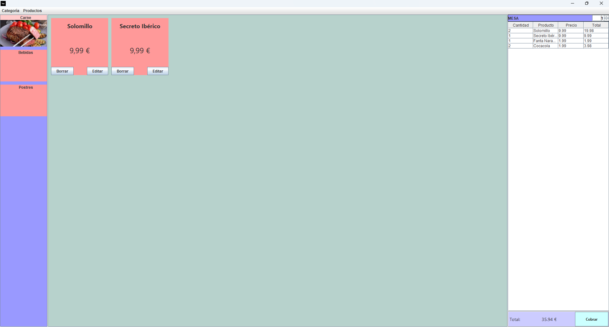
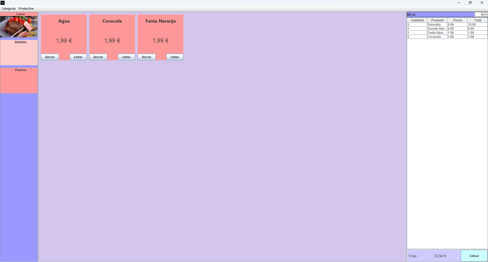
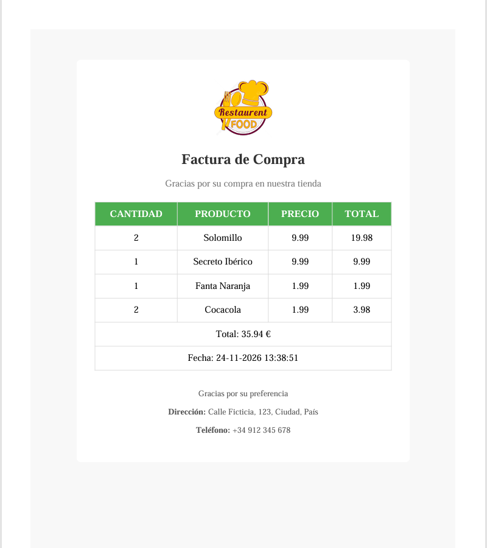

# TPV – aplicación de escritorio

Prototipo académico de un punto de venta desarrollado con Java 17, Swing, Maven y NetBeans. Permite crear categorías y productos, gestionar varios pedidos, modificar cantidades y generar documentos PDF de cobros simulados.

#### **Capturas de pantalla**

##### Interfaz principal y Gestión de pedidos

Gestión de categorías y productos.

Selección de productos, gestión de cantidades y cálculo automático del importe total.

##### Generación de facturas

Generación de facturas en formato PDF a partir de los datos del pedido.

